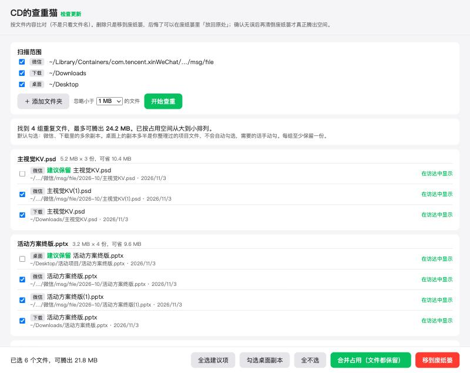
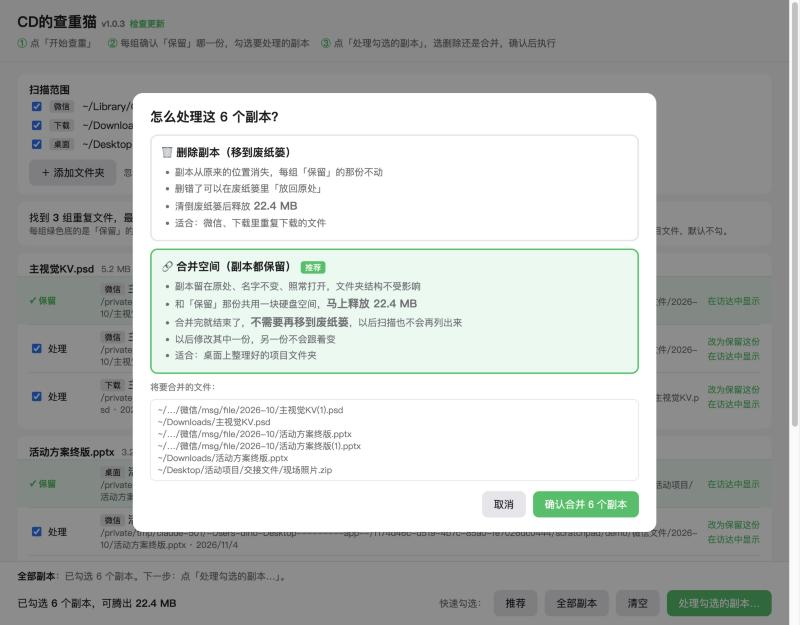

# CD的查重猫

一个免费的 Mac 小工具：**找出重复下载的微信文件，帮你腾出硬盘空间**。

同一个文件在微信里点了好几次下载，就会多出 `方案(1).pptx`、`方案(2).pptx`；再存到「下载」、拷到桌面……一个文件占好几份空间。查重猫一次把它们都找出来。

适用于 Apple 芯片（M 系列）Mac，macOS 14 及以上。

## 下载

👉 [下载最新版](https://github.com/Dino12138/chachongmao-releases/releases/latest)：点开后在 Assets 里下载 `ChaChongMao-版本号.dmg`。

装好以后有新版本，App 顶部会出现绿色提示，点「立即更新」，几秒钟就好：**不用重新下载安装，也不用重新授权**。

---

## 它能做什么

- **按内容查重，不看文件名**：改过名的副本也能找出来；同名但内容改过的文件不会被当成重复，不会误删新版本。
- **默认扫描**：微信收到的文件和视频、「下载」、「桌面」、「文稿」，也可以点「＋ 添加文件夹」加别的位置。扫描中途可以随时「停止扫描」。
- **每组自动定一份「保留」**（绿色底）：优先桌面、文稿里整理过的 › 微信里原名、较早的那份 › 下载里的。想留另一份，点那一行的「改为保留这份」。保留的那份永远不会被处理。
- **两种处理方式，执行前都会弹窗确认**：

| | 🗑 删除副本（移到废纸篓） | 🔗 合并空间（副本都保留） |
|---|---|---|
| 副本还在不在原处 | 不在，进了废纸篓 | 在，名字不变、照常打开 |
| 什么时候腾出空间 | 清倒废纸篓之后 | 马上 |
| 能不能反悔 | 废纸篓里「放回原处」 | 不需要反悔，文件都在 |
| 适合 | 微信、下载里重复下载的文件 | 桌面、文稿里整理好的项目文件夹 |

合并完就结束了，**不需要再移到废纸篓**；以后再扫描，合并过的不会再列出来。（合并后两份文件都还在、互相独立：改其中一份，另一份不受影响，改动的部分会重新占用空间。）

## 安装

1. 打开 dmg，把「CD的查重猫」拖进「应用程序」。
2. 第一次打开如果提示「无法验证开发者」：双击安装包里的「打不开时双击我.command」，或到 系统设置 › 隐私与安全性 最下面点「仍要打开」。
3. **允许读取微信文件**：App 里出现红框「还读不到微信文件夹」时，点「打开系统设置」，在「完全磁盘访问权限」里打开「CD的查重猫」的开关（列表里没有就点 ＋ 从「应用程序」里添加），然后退出 App 再重新打开。

## 使用教程

1. 打开 App，确认要扫描的文件夹，点「开始查重」（几十 GB 一般半分钟左右；中途可以点「停止扫描」）。
2. 结果按占用空间从大到小排列。每组绿色底的是「保留」的那份；想留另一份，点「改为保留这份」。点「在访达中显示」可以先看看文件。
3. 勾选要处理的副本。底部「快速勾选」可以一键勾：
   - **推荐**：只勾微信、下载里的多余副本
   - **全部副本**：除了保留的那份，全部勾上（包括桌面）
   - **清空**：取消所有勾选
4. 点「处理勾选的副本…」，在弹窗里选「删除副本」或「合并空间」，看一眼文件清单，点确认。
5. 选了删除的话，确认没删错后清倒废纸篓，空间才会真正腾出来。

鼠标移到底部按钮上，会显示每个按钮的作用。

## 常见问题

- **删掉微信里的副本，聊天记录会受影响吗？** 聊天窗口里那条旧文件可能打不开，但你保留的那份不受影响。
- **为什么点「推荐」没勾上东西？** 剩下的重复都在桌面上，这类默认不勾；需要的话点「全部副本」，再选「合并空间」。
- **合并之后还要移到废纸篓吗？** 不用。合并完空间已经腾出来了，文件也都还在。
- **怎么检查更新？** 窗口标题旁边的「检查更新」。
- **Intel 芯片的 Mac 能用吗？** 目前不能。
- **提示「不能与此版本的 macOS 配合使用」？** 需要 macOS 14 及以上；如果你已经是 14、15，请下载 1.0.1 及以后的安装包。

## ☕ 赞助支持

查重猫是我利用业余时间独立开发和维护的，**完全免费、没有广告**。

如果它帮你省下了空间和时间，欢迎请我喝杯咖啡 ☕️ 你的支持会让我更有动力持续更新。

赞助完全自愿，不赞助也可以一直免费使用。也欢迎点个 ⭐ Star 支持一下～

**感谢每一位支持者！** 🙏

我的另一个免费小工具：[CD的拾光猫](https://github.com/Dino12138/shiguangmao-releases)：截图标注、长截图、录屏、剪贴板与刘海灵动岛。

## 更新记录

### 1.0.3 · 操作更清楚

- 每组可以「改为保留这份」，自己决定留哪一份
- 处理前弹窗：选「删除副本」或「合并空间」，列出将要处理的文件，确认后才执行
- 合并过的副本以后扫描不再列出
- 扫描中途可以「停止扫描」
- 底部按钮改为「快速勾选：推荐 / 全部副本 / 清空」+「处理勾选的副本…」

### 1.0.2 · 独立窗口 · 按钮说明

- App 有了自己的窗口，菜单栏和程序坞都显示「CD的查重猫」（之前借用 Chrome 窗口，显示的是 Google Chrome）
- 鼠标移到底部按钮上，会显示每个按钮的作用；点完选择按钮会说明勾了什么、下一步做什么
- 1.0.0、1.0.1 的用户：App 里点「去下载」，重新安装这一版

### 1.0.1 · 支持旧系统

- 修复 macOS 14、15 上打开提示「不能与此版本的 macOS 配合使用」
- 1.0.0 打不开的话，请重新下载安装包

### 1.0.0 · 首个版本

- 按内容查重：微信文件、下载、桌面，可添加其他文件夹
- 移到废纸篓 / 合并占用（文件都保留）两种处理方式
- 在线热更新：更新不用重装、不用重新授权
